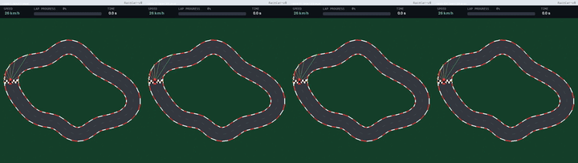

# PPO 

This is my implementation of Proximal Policy Optimization (PPO) in PyTorch for my Advanced Topics in AI course. The code is based on the original paper by OpenAI: [Proximal Policy Optimization Algorithms](https://arxiv.org/abs/1707.06347). I generated the race track environment using Claude Fable 5.2 to be very learnable for the model while being fun to watch and play.

I used Gymnasium, PyTorch, and Numpy for the implementation. 